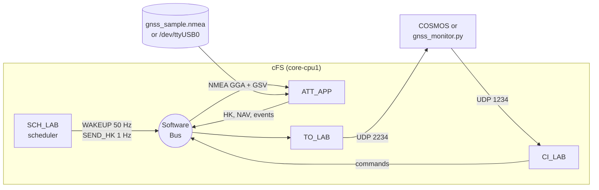

# ATT_APP: GNSS signal-health monitor for NASA cFS

ATT_APP is a flight software application for NASA's [Core Flight System (cFS)](https://github.com/nasa/cFS). It reads a GNSS receiver's NMEA output, publishes position and per-satellite signal strength as telemetry, and flags degraded signals and possible interference (jamming) on board, so the ground sees the problem as an event and a red flag instead of digging for it in raw numbers.

It runs on cFS's Linux build. Input comes from a recorded log by default, or from a live receiver on a serial port. An [OpenC3 COSMOS](../../tools/att_app_cosmos/README.md) plugin and a stand-alone Python ground tool serve as the ground system.

## Why signal health

A GNSS receiver tells you where you are and also how well it can hear each satellite (C/N0, the carrier-to-noise density, in dB-Hz). Healthy open-sky signals are around 40–48 dB-Hz. What matters is how C/N0 *changes*:

- **One satellite weak:** usually geometry (low elevation, a building, the vehicle's own body). Worth noting, not alarming.
- **Every satellite drops by about the same amount at the same moment:** that is what a broadband jammer looks like. Satellites are spread across the sky, so nothing physical except a strong in-band signal near the receiver drags them all down together.
- **Most satellites disappear but the ones left are as strong as before:** the sky is blocked (a tunnel, a parking structure), not jammed.

ATT_APP tells these apart. That is the core of the project.

## What it does

| Flag (NAV `HealthFlags`) | Sets when | Clears when |
|---|---|---|
| `NO_FIX` (0x01) | the receiver reports fix quality 0 for 1 epoch | a fix is reported for 2 epochs |
| `LOW_CNO_SAT` (0x02) | the weakest tracked satellite is below the threshold (default 30 dB-Hz, commandable) | all tracked satellites are at threshold + 2 dB or more |
| `BROADBAND_DROP` (0x04) | for 2 epochs: mean C/N0 is ≥ 8 dB below its running baseline **and** ≥ 75% of satellites with a trusted baseline are ≥ 6 dB below their own, or untracked | mean C/N0 is within 4 dB of baseline for 3 epochs |

Each flag sends exactly one event when it sets and one when it clears. Baselines freeze while a drop is being judged or is active, so a jammer cannot train the alarm to accept it. See [docs/DESIGN_NOTES.md](docs/DESIGN_NOTES.md) for the reasoning.

## Architecture



Inside ATT_APP, every 50th wakeup (1 Hz) runs one GNSS tick:

```
OS_TimedRead (non-blocking) -> split lines -> NMEA parser -> epoch assembler
    -> health checks -> events on flag changes -> NAV packet on the software bus
```

| File | Role |
|---|---|
| `fsw/src/att_app.c` | Entry point, init, main loop |
| `fsw/src/att_app_dispatch.c` | Routes messages by ID and command code, checks lengths |
| `fsw/src/att_app_cmds.c` | Command handlers, HK, the 50 Hz wakeup |
| `fsw/src/att_app_gnss.c` | Input (file or device), line splitting, publishing NAV, health events |
| `fsw/src/att_app_nmea.c` | Pure NMEA parser and epoch assembler (no cFE calls) |
| `fsw/src/att_app_health.c` | Pure health checks and debouncing (no cFE calls) |

## Messages

| Packet | MID | Rate | Contents |
|---|---|---|---|
| Command | `0x1887` | — | see below |
| SEND_HK | `0x1888` | 1 Hz from SCH_LAB | request for HK |
| WAKEUP | `0x188F` | 50 Hz from SCH_LAB | drives the GNSS tick |
| HK | `0x0889` | 1 Hz | command and error counters, C/N0 threshold, input state, wakeup/epoch/parse-error counters (16-byte payload) |
| NAV | `0x0893` | 1 Hz | UTC time, lat/lon/alt, fix quality, satellites used and in view, mean C/N0, health flags, epoch and parse-error counters, 12 × {PRN, C/N0} (64-byte payload) |

| Command | Code | Payload | Effect |
|---|---|---|---|
| NOOP | 0 | — | bumps the command counter, sends the version event |
| RESET_COUNTERS | 1 | — | zeroes the command, error, epoch and parse-error counters |
| SET_CNO_THRESHOLD | 2 | `uint8` dB-Hz + 3 padding bytes | new low-C/N0 threshold, accepted only in 10–55 |
| RESTART_LOG | 3 | — | reopens the input from the start and clears the health history (keeps the threshold) |

Wrong lengths, unknown codes and out-of-range values bump `CommandErrorCounter` and send an error event.

## Build and run (WSL Ubuntu)

```bash
git clone --recurse-submodules -b feature/gnss https://github.com/muta4613/cFS ~/cFS
cd ~/cFS
make native_std.prep && make native_std.install
```

If `core-cpu1` aborts with `OS_QueueCreate Error`, raise the message queue limit (it resets on reboot):

```bash
echo 1000 | sudo tee /proc/sys/fs/mqueue/msg_max
```

Terminal 1, flight software:

```bash
cd ~/cFS/build-native_std/exe/cpu1 && ./core-cpu1
```

Terminal 2, ground monitor (asks TO_LAB to start sending, then prints a line per second):

```bash
cd ~/cFS && python3 apps/att_app/ground/gnss_monitor.py --enable-tlm
```

Terminal 3, commands:

```bash
python3 apps/att_app/ground/gnss_monitor.py --send-cmd noop
python3 apps/att_app/ground/gnss_monitor.py --send-cmd set-cno-threshold 31
python3 apps/att_app/ground/gnss_monitor.py --send-cmd restart-log
```

The recorded log is 5 minutes long and has three scripted events: PRN 21 fades by itself at 60–99 s, every satellite drops 10–15 dB at 150–179 s, and the fix is lost at 230–239 s with 7 of 10 satellites gone. It is generated by `ground/make_nmea_log.py`.

### Example run

From a 335 s run, trimmed (threshold commanded to 31 dB-Hz):

```
HK  cmd=1 err=0 threshold=30dB-Hz ...
EVT ATT_APP 26 INFO: ATT_APP: C/N0 threshold changed from 30 to 31 dB-Hz
EVT ATT_APP 27 ERROR: ATT_APP: C/N0 threshold 200 dB-Hz rejected, valid range is 10 to 55; threshold stays 31
EVT ATT_APP 6 ERROR: ATT_APP: Invalid Msg length: ID = 0x1887,  CC = 0, Len = 9, Expected = 8
HK  cmd=2 err=2 threshold=31dB-Hz input=OPEN ...

NAV 18:00:10 fix=1 used=10 view=10  39.74000 -104.98998 1600.7m meanCN0=43.1 flags=none | 02:48 05:45 07:47 09:41 13:44 15:37 18:46 21:44 26:39 30:40

# one satellite fades (PRN 21)
NAV 18:01:03 fix=1 used=10 view=10  39.73999 -104.99003 1600.3m meanCN0=41.2 flags=LOW_CNO_SAT | ... 21:26 ...
EVT ATT_APP 22 INFO: ATT_APP: low C/N0 on PRN 21: 26 dB-Hz, threshold 31

# every satellite drops at once
NAV 18:02:30 fix=1 used=10 view=10  39.74000 -104.99001 1600.7m meanCN0=36.9 flags=none | 02:40 05:39 07:41 09:34 13:35 15:34 18:40 21:37 26:33 30:36
NAV 18:02:32 fix=1 used=10 view=10  39.74000 -104.99003 1601.5m meanCN0=30.8 flags=LOW_CNO_SAT,BROADBAND_DROP | 02:36 05:33 07:34 09:27 13:28 15:26 18:34 21:33 26:27 30:30
EVT ATT_APP 24 ERROR: ATT_APP: possible interference: mean C/N0 30.8 dB-Hz is 11.7 dB below baseline, 10 of 10 satellites dropped
EVT ATT_APP 25 INFO: ATT_APP: interference cleared: mean C/N0 back to 42.8 dB-Hz

# fix lost; the 3 satellites left are as strong as ever, so no interference flag
NAV 18:03:50 fix=0 used= 3 view=10    (no position)              meanCN0=46.0 flags=NO_FIX | 02:46 05:-- 07:47 09:-- 13:-- 15:-- 18:45 21:-- 26:-- 30:--
EVT ATT_APP 20 ERROR: ATT_APP: GNSS fix lost at 18:03:50 UTC, 3 satellites tracked
EVT ATT_APP 21 INFO: ATT_APP: GNSS fix regained at 18:04:01 UTC, 10 satellites tracked
EVT ATT_APP 17 INFO: ATT_APP: end of GNSS log after 300 epochs, replaying from the start
```

335 NAV packets in 335 s, 0 parse errors, and `BROADBAND_DROP` never set during the no-fix window.

## Live receiver

The same code reads a serial device. Copy [config/examples/device_att_app_internal_cfg_values.h](config/examples/device_att_app_internal_cfg_values.h) to `sample_defs/cpu1_att_app_internal_cfg_values.h`, set the device name (`ttyUSB0`, `ttyACM0`…), set the baud rate with `stty`, and rebuild. To test without hardware, `ground/pty_feed.sh` creates `/tmp/gnss_pty` with socat and plays the log into it at 1 Hz; the example config points there. Tested: 20 NAV packets in 20 s through the pty, and a missing device raises an error event while the app keeps running.

## Ground system

- **COSMOS:** [tools/att_app_cosmos](../../tools/att_app_cosmos/README.md) has every command and packet, a health screen (red: interference, no fix; yellow: low C/N0) and setup steps.
- **Python:** `ground/gnss_monitor.py` (standard library only) decodes HK, NAV and events, sends every command, and can save a capture (`--capture FILE`).

## Tests

| Check | Result |
|---|---|
| Unit tests, 6 runners (`build-native_std/exe/cpu1/coverage-att_app-*-testrunner`) | 1,742 assertions, 0 failures |
| Line coverage | 100% on every flight source file (branches: 96.6–100%) |
| Parser under ASan/UBSan (`make -C apps/att_app/unit-test/standalone check`) | 300-epoch log replay plus 76,800 corrupted sentences, no errors |
| COSMOS layout (`tools/att_app_cosmos/test/check_layout.py`) | 9 packets, 55 fields, 5 commands, 335 + 335 captured packets match |
| Topic-ID uniqueness (`unit-test/check_topic_ids.py`) | no ATT_APP topic ID used elsewhere in the mission |
| Live run in CI (`.github/workflows/att-app.yml`) | 40 s run with commands, capture decoded through the COSMOS definitions |

## Limitations and next steps

- The detector looks for a *change*. A receiver switched on while already jammed learns the low level as normal, a drop in the first 10 epochs isn't judged, a fade slower than the 30-epoch average is tracked rather than flagged, and if the signal never recovers the flag stays set until `RESTART_LOG`.
- In device mode an epoch is published when the next GGA arrives, so NAV lags the receiver by up to one second. A receiver that goes silent produces no NAV and no event; there is no "input stale" flag yet.
- The test data is synthetic. Next: replay a real recorded log from a lab receiver, including a real interference event.
- The EDS build of ATT_APP has not been compiled (the mission EDS files have no ATT_APP entries).
- The COSMOS plugin's definitions are verified against the C structs, but it hasn't been run in a live COSMOS yet.
- Longer term: an FPGA GNSS correlator front end, so the signal-health measurements come from my own tracking loops instead of a receiver's NMEA output.

## License

Apache 2.0. ATT_APP started as NASA's `sample_app`; the GNSS, health, command and ground code is new.
